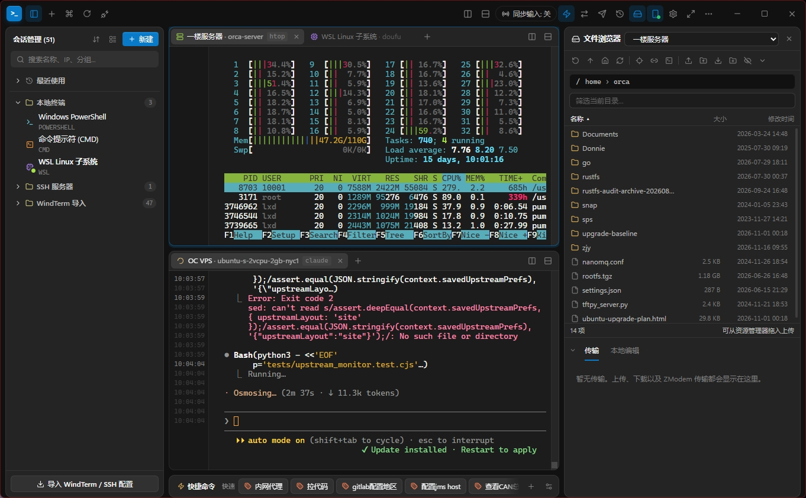
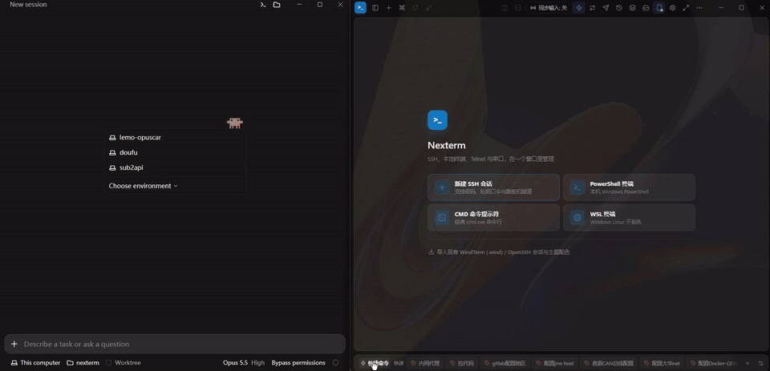
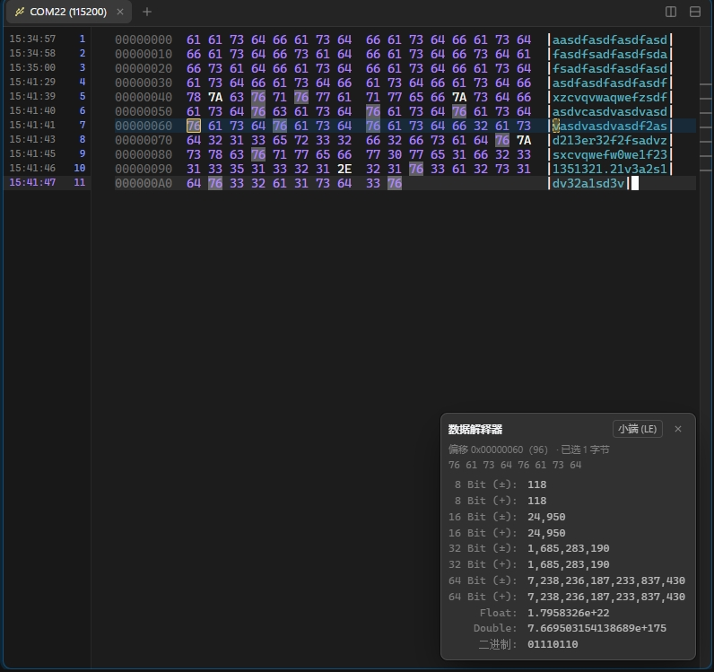

# Nexterm

English | [简体中文](README.zh-CN.md)


**Nexterm** is a fast, modern Windows terminal client built with Rust, Tauri v2, React, and [xterm.js](https://xtermjs.org), supporting **SSH, local shells (PowerShell / CMD / WSL), Telnet, raw TCP, serial ports, Android (ADB)**, and embedded **RDP / VNC** remote desktops.

It keeps WindTerm's productive workflow (session tree, nested splits, quick commands, one-click migration) and adds deep tooling for daily engineering, ops, and AI agents. Windows 10 / 11 only · v`0.1.16` ([Download Releases](https://github.com/rty813/nexterm/releases)).



## Highlights

- **All-in-One Protocols & Remote Desktop**: Run SSH, local ConPTY, Serial, ADB, and embedded RDP / VNC side by side in one workspace.
- **Integrated File Workflow**: Side-by-side SFTP browser (automatic SCP fallback) with parallel transfers, instant previews, and **local edit with auto-upload on save**.
- **AI Agent Integration**: Live tab badges and desktop notifications for **Claude Code / Codex / Gemini CLI**, plus a built-in human-in-the-loop **MCP server**.
- **Zero-Knowledge Remote Access & Sharing**: Control desktop terminals from any phone or browser via QR code with E2EE, or share a single terminal via a one-off link with on-request control.
- **Full Scrollback & Plugins**: Compressed backend scrollback for every line ever printed with fast whole-history search, plus an installable plugin platform and store.

## Features

### Connections & Protocols

- **SSH** (`russh`): Password, `keyboard-interactive`, and private-key auth (OpenSSH / PEM, Ed25519 / RSA), ProxyJump, ProxyCommand, keep-alive, post-login scripts, and TOFU host-key verification.
- **Proxies & Anti-Idle**: SOCKS5 / SOCKS4(a) / HTTP CONNECT proxy support; backend anti-idle keep-alive (skips full-screen TUIs and running commands) to prevent `TMOUT` logouts.
- **Local & Hardware**: Bundled modern Microsoft ConPTY (`OpenConsole`) for PowerShell / CMD / WSL, plus Telnet, raw TCP, and serial ports.
- **Embedded RDP / VNC**: NLA, TOFU certificate verification, bidirectional clipboard (including files & folders), local audio playback, pane-driven dynamic resize, and macOS Screen Sharing—routable through SSH jump hosts or proxies.
- **Port Forwarding & In-Band Transfers**: Local (`-L`), remote (`-R`), and dynamic (`-D`) forwarding; one-click X11 via bundled VcXsrv; **ZMODEM / XMODEM / YMODEM** (with conflict handling) and session logging.
- **Shell Integration**: Automatic prompt, command, and directory tracking (OSC 133 / 633 / 7) for SSH (`bash` / `zsh` / `fish`), WSL, and local PowerShell, plus one-click context-menu install for nested shells and serial consoles.

### Remote File Browser (SFTP / SCP)

- **Automatic Fallback & Sync**: Open with `Ctrl+Shift+O`; falls back to SCP + shell when SFTP is unavailable. Includes path auto-completion, **auto-follow terminal `cd`**, and per-server or shared folder bookmarks (`Ctrl+D`).
- **Instant Previews & Live Local Edit**: Preview code, JSON, Markdown, CSV/TSV, images, and PDFs without downloading; edit remote files in your local editor with auto-upload on every save.
- **High-Throughput Transfer Queue**: Drag-and-drop folders/files, permission editing, pause / resume / retry, conflict rules, and unified ZMODEM progress. Larger in-flight pipeline gives ~4× faster uploads and ~3.5× faster downloads over 200 ms links.

### Android Devices (ADB)

- **Direct `adb` Server Protocol**: USB, Wi-Fi debugging, and Android 11+ wireless pairing; auto-locates `adb.exe` or downloads Google's official `platform-tools` in one click. Quick-connect supports `adb` and `adb <serial|ip>`.
- **Screen Mirror & Recording**: Bundled [scrcpy](https://github.com/Genymobile/scrcpy) server with WebCodecs hardware decoding—mouse/keyboard/IME input, screen-off mirroring, bidirectional clipboard, screenshots, and zero-reencode MP4 recording.
- **Logcat & Device Management**: Dedicated Logcat workspace tabs (filter by level, `tag:`, `pid:`, `package:`, regex without losing lines); browse device files, install/export APKs, manage apps & processes, and view device resources.
- **Remote-Host ADB**: Right-click any Linux SSH pane to manage Android devices plugged into that remote host (automatically relays via `nc` if port forwarding is blocked).

### AI Agents & MCP Server

- **Live Status & Notifications**: Tabs show whether Claude Code, Codex, or Gemini CLI is **Working**, **Waiting for Approval**, **Finished**, or in **Error**; taskbar flash + system notification lets you jump straight to the pane.
- **One-Click Hooks + Screen Fallback**: Install status hooks in one click for local Windows, SSH, and WSL, with automatic screen-detection fallback.
- **Human-in-the-Loop MCP Server**: Expose Nexterm to AI agents to read screens/history, run commands, drive TUIs (`vim`, `top`), and upload/download files on SSH panes via SFTP/SCP. Every takeover or new session requires **dialog approval**, locks pane keyboard input during delegation, and can be paused or reclaimed anytime.

<p align="center">
  <a href="docs/media/mcp-demo.mp4"></a>
  <br />
  <sub>Claude Code opens a WSL pane via Nexterm's MCP server, checks disk usage, and closes it (2.5× speed; click for full video).</sub>
</p>

### Remote Access & Session Sharing

- **Self-Hosted Zero-Knowledge E2EE**: Lightweight self-hosted relay ([relay/README.md](relay/README.md), Docker included). Pair by QR code or link from a phone or desktop browser; keys stay in the URL `#` fragment and the relay sees only AES-256-GCM ciphertext.
- **Mobile-Ready & Full Control**: Installable PWA with touch bar (`Esc`, `Tab`, `Ctrl`, `Alt`, arrows) and **"Take over size"** adaptive dimensions; supports remote SSH login / host-key confirmation, session management, file transfers up to 1 GB, and read-only mode (up to 8 devices).
- **One-Off Session Sharing**: Generate a temporary link and QR code for a single pane (in-memory key, invalidated on stop / close / expiry). Viewers need no install and are read-only by default; grant single-viewer input and resize control on request.

<p align="center">
  <a href="docs/media/phone-remote.mp4"></a>
  <br />
  <sub>Controlling a desktop SSH session from a phone with "Take over size" adapting to the mobile screen (1.5× speed; click for full video).</sub>
</p>

### Workspace, Triggers & Binary Debugging

- **Flexible Layout & Fast Input**: Searchable nested session tree, arbitrary split panes, and tear-off windows; Quick-Connect bar (`ssh` / `rdp://` / `vnc://` / `adb` / `wsl` / `powershell`), **Broadcast Input**, timed multi-session Sender, Command Palette, multi-row grouped Quick Commands, and history/dictionary auto-complete.
- **Alerts & Focus**: One-shot command-finish notifications (duration + exit code), output folding, highlight rules, Focus Mode (`F11`), pin-on-top, workspace lock, and close-to-tray.
- **Triggers**: Built-in hyperlinks (including OSC 8), hex-to-dec/oct converter, Unix timestamp converter, and one-click archive extractors; create custom triggers with named-group regexes and sandboxed Worker tooltip scripts.
- **Serial & Binary (Hex)**: Hex dump view for Serial / raw TCP, an integrated **WinHex-style Data Interpreter** (click any byte for big/little-endian 8–64-bit ints, floats, and bits; click to copy), and a multi-format Hex packet sender.



### Full Scrollback & Search

- **Seamless Back-to-Start History**: Scroll all the way back to line 1 in the same terminal with a whole-history scrollbar; search the entire history (`Ctrl+Shift+F`, case / whole-word / regex) with scrollbar marks.
- **Gutter & Full Export**: Toggle per-line timestamps and line numbers (`Ctrl+Shift+S`). **Save to file** and MCP `read_history` / `search_history` cover the full history, with configurable memory and temp-file caps.

### Sync, Migration & Customization

- **Cloud Sync & Versioned Backups**: Sync sessions, commands, themes, settings, history, and plugins to **S3-compatible storage, WebDAV, GitHub Gist, or a local/network folder**, with conflict resolution, point-in-time restore, and password-encrypted export/import (PBKDF2 + AES-256-GCM). Machine-local settings stay local.
- **Easy Migration**: One-click import from **WindTerm** (including optional credentials, quick commands, and themes), `~/.ssh/config`, **Xshell**, **MobaXterm**, **SecureCRT**, and **FinalShell**.
- **Security & Ops**: Shared **Credential Manager** across SSH / RDP / VNC sessions and jump hosts; local secrets encrypted with Windows DPAPI; built-in **Server Resources** panel (CPU, RAM, network, disk, uptime) for Linux SSH panes.
- **Customization & Maintenance**: 20 built-in themes + custom theme editor + synced terminal background image; customizable shortcuts, toolbar, English / Simplified Chinese UI, searchable settings (`Ctrl+F`), SHA-256-verified in-app updater, and app proxy settings.

### Plugins (Experimental)

Install local `.nexterm-plugin` packages or subscribe to public plugin stores (Ed25519-verified on first add) under **Settings → Plugins**, with permission review, enable/disable, reload, and sync support. **Install only plugins you trust** (VS Code `.vsix` is not supported).

Quick start: pack the [Hello template](plugins/hello/) with `node scripts/pack-plugin.mjs plugins/hello` and install the resulting package.

- [Plugin development guide (Chinese)](docs/plugin-sdk.zh-CN.md) · [SDK type definitions](plugins/sdk/nexterm.d.ts) · [Platform design (Chinese)](docs/plugin-platform.zh-CN.md) · [Publishing a store (Chinese)](docs/plugin-store.zh-CN.md)

## Performance

Compared with WindTerm 2.7.0 using WindTerm's [throughput benchmark](https://github.com/kingToolbox/WindTerm#terminal-performance) (lower is better; Nexterm running with full scrollback enabled by default):

| Test | Nexterm | WindTerm 2.7.0 |
| --- | --- | --- |
| `cat` 100 MB random base64 text | 5.53 s | **4.98 s** |
| `seq 1 1000000` | **1.43 s** | 2.04 s |
| `seq 1 2000000` | **2.23 s** | 2.97 s |
| `seq 1 5000000` | 5.38 s | **4.73 s** |
| `seq 1 10000000` | 10.15 s | **7.54 s** |

Memory (private working set of the whole process tree, including WebView2):

| State | Nexterm | WindTerm 2.7.0 |
| --- | --- | --- |
| Idle, one session open | 218 MB | **43 MB** |
| After `seq 1 1000000` | 350 MB peak, 248 MB settled | **75 MB** |

<details>
<summary>Benchmark setup, memory breakdown, and reproduction</summary>

- **Where memory goes**: ~170 MB is WebView2's fixed baseline. xterm.js keeps only the latest 10,000 lines; older output is compressed in Rust (~20 MB for `nexterm.exe` after `seq 1 1000000`). The peak is mostly uncollected JS garbage freed within seconds.
- **Full-history cost**: A dedicated backend thread parses and compresses output (~1 extra CPU core during heavy streams). Throughput is nearly identical: in back-to-back runs, `seq 1 10000000` took 8.9 s on vs. 8.7 s off.
- **Setup**: AMD Ryzen 7 5700G, 32 GB RAM, Windows. Both terminals connected over Telnet to local WSL at identical window size; 1 warm-up + median of 3 runs (timed via DSR reply, or CPU idle for WindTerm since it does not answer DSR over Telnet).
- **Reproduce**: Run [`bench/bench.sh`](bench/bench.sh) inside the terminal under test and [`bench/mem.ps1`](bench/mem.ps1) on Windows.

</details>

<details>
<summary>Architecture: how full scrollback achieves low memory and ~0.1 s search in WebView</summary>

xterm.js stores fixed-width cells (12 bytes/cell), which would take ~15 GB for 10M lines. Nexterm stores the full history in the Rust backend and streams slices into xterm.js on demand ([`src-tauri/src/history/`](src-tauri/src/history/), [`src/services/historyScroll.ts`](src/services/historyScroll.ts)):

1. **Headless backend terminal**: Output is mirrored to a worker thread running [`alacritty_terminal`](https://crates.io/crates/alacritty_terminal), faithfully handling cursor moves, `\r` progress bars, clears, and logical line wrapping.
2. **Compact zstd blocks**: Lines are stored as text, color runs, and timestamps in 2,000-line zstd-compressed blocks (`seq 1 10000000` compresses from 78 MB to ~6 MB).
3. **Bounded memory + encrypted spill**: Past the per-pane memory cap (default 32 MB), oldest blocks are encrypted with an ephemeral AES-256-GCM key and spilled to temp files (deleted on close; capped at 2 GB by default).
4. **Seamless on-demand splicing**: Scrolling near the top of xterm.js fetches older lines and splices them directly into the buffer (up to ~30k extra rows, freed on returning to the bottom), keeping selection, copy, links, and highlights working transparently.
5. **Parallel whole-history search**: Multi-threaded search scans compressed blocks in ~0.1 s across 10M lines, pre-filtering per block and caching per-block match counts for instant scrollbar marks.

</details>

## Building from Source

Prerequisites: [Node.js](https://nodejs.org) >= 20, [Rust](https://rustup.rs) stable (MSVC), and [Tauri v2 Windows prerequisites](https://tauri.app/start/prerequisites/).

```powershell
git clone https://github.com/rty813/nexterm.git
cd nexterm
npm install

npm run tauri:dev      # development mode
npm run tauri:build    # release build -> src-tauri/target/release/nexterm.exe (quit running nexterm.exe first)
```

Run tests:

```powershell
npm test                                                 # front-end tests (Vitest)
cargo test --manifest-path src-tauri/Cargo.toml --lib    # Rust unit tests
cd relay; npm test                                       # relay & E2EE protocol tests
```

### Project Layout

| Path | Contents |
| --- | --- |
| `src/` | Front end (React + TypeScript); `utils/` holds UI-independent logic and unit tests |
| `src-tauri/` | Rust backend: protocols & proxies, RDP / VNC, SFTP / SCP, ADB / scrcpy, full scrollback, MCP, remote access & sharing |
| `relay/` | Self-hosted relay server, remote access PWA, and session share page (Node.js) |
| `plugins/` | Hello starter plugin and SDK type definitions |
| `bench/` | Throughput and memory benchmark scripts |

## Contributing & Community

- Issues and PRs are welcome. Please run front-end and Rust tests before submitting, and provide both English and Chinese strings for new UI text.
- Community: [LINUX DO](https://linux.do/)

## License

Dual-licensed under [MIT](LICENSE-MIT) or [Apache-2.0](LICENSE-APACHE). The bundled [VcXsrv](https://sourceforge.net/projects/vcxsrv/) (`src-tauri/resources/vcxsrv/`) is a separate program under GPL-2.0; the bundled [scrcpy](https://github.com/Genymobile/scrcpy) server (`src-tauri/resources/scrcpy/`) is Apache-2.0; other dependencies keep their own licenses.
