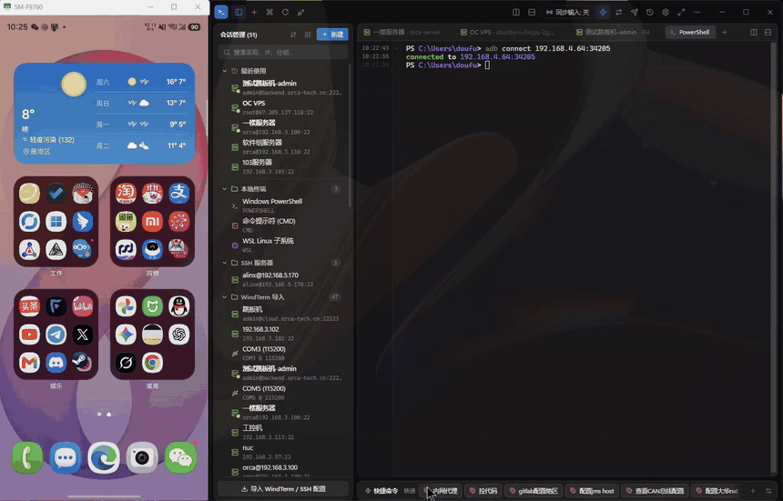

# Nexterm

English | [简体中文](README.zh-CN.md)


**Nexterm** is a fast, modern Windows terminal client supporting SSH, local shells (PowerShell / CMD / WSL), Telnet, raw TCP, serial ports, and embedded RDP / VNC remote desktops—built with Rust, Tauri v2, React, and [xterm.js](https://xtermjs.org).

It keeps WindTerm's familiar workflow (session tree, nested split panes, quick commands, one-click import from WindTerm, Xshell and MobaXterm) and adds several built-in capabilities:

- **Remote File Workflow**: Side-by-side SFTP browser (with automatic SCP fallback), parallel transfer queue, instant previews, and **local edit with auto-upload on save**.
- **AI Agent Awareness & Control**: Live tab badges for **Claude Code / Codex / Gemini CLI**; desktop notifications when an agent **finishes, needs permission approval, or errors out** (click to jump straight to the pane); plus a built-in MCP server for human-approved terminal delegation.
- **E2EE Remote Access & Session Sharing**: Scan a QR code or open a link to view and control desktop terminals from any browser (phone or computer), adapt terminal dimensions to a phone screen, manage sessions, transfer files, or share a single session through a one-off link (read-only until you grant control), all with zero-knowledge encryption.
- **Full Scrollback History**: Every line a pane ever printed stays available, compressed in the background. Scroll, search and export all of it, back to the start of the session.
- **Installable Plugins**: Extend Nexterm with your own commands, views and dynamic session lists without modifying the host. [Start with the Hello counter](#plugins-experimental).

Windows 10 / 11 only. Current version: `0.1.13`.


## Features

### Connections

- **SSH** (`russh`): Password, `keyboard-interactive`, and private-key auth (OpenSSH / PEM, Ed25519 / RSA, passphrase support), ProxyJump, keep-alive, post-login scripts, and first-connect host key verification.
- **Proxies**: SSH, Telnet and raw TCP sessions can connect through a **SOCKS5** (username / password), **SOCKS4 / 4a** or **HTTP CONNECT** (Basic auth) proxy. SSH sessions can also use an OpenSSH-style **ProxyCommand** (`%h` / `%p` / `%r`), e.g. `ssh -W %h:%p bastion`. With a jump host, the proxy is used to reach the jump host.
- **Anti-Idle**: After a set number of seconds without input, a session sends a string (`\0` by default; escapes such as `\n` and `\xHH` work) so servers that log out inactive users (`TMOUT`, `autologout`, `exec-timeout`) keep you in. SSH keep-alives cannot do this. The timer runs in the backend, so it keeps working while the window is minimized, and it holds off while a full-screen program (vim, top …) or a command is running. Works with every protocol; turn it on under **More** in the session settings.
- **Local & Hardware Protocols**: Native ConPTY local shells (PowerShell / CMD / WSL / custom commands), Telnet, raw TCP, and Serial ports. Local shells use Microsoft's current ConPTY (OpenConsole), bundled with Nexterm, rather than the one in your Windows version; the system ConPTY is used only if the bundled files are missing or fail to load.
- **RDP / VNC Remote Desktop**: Open remote desktops in a tab or split pane, next to your terminals. RDP supports NLA, server certificate confirmation on first connect, clipboard sync, remote audio played locally, and resizes the remote resolution with the pane; VNC supports VNC password auth and macOS Screen Sharing (fill in a username). Connect through an SSH jump host or a SOCKS / HTTP proxy. Scale to fit, show at original size or stretch, go full screen, send `Ctrl+Alt+Del`, and reconnect after a drop. Type `rdp://user@host` or `vnc://host:5901` in the quick-connect bar.
- **Shell Integration**: Automatically tracks prompts, commands, and working directories (OSC 133 / 633 / 7) in SSH `bash` / `zsh` / `fish` and local `PowerShell`. The context menu's **Load shell integration** installs scripts and startup configuration for the current `bash` / `zsh` / `fish` user, taking effect immediately and in future sessions, including WSL, SSH, nested shells, and serial consoles. Existing startup files are backed up as `.nexterm-si.bak` before changes.
- **Forwarding & In-Band Transfers**: Local (`-L`), remote (`-R`) and dynamic (`-D`, a local SOCKS4 / 4a / 5 proxy whose connections go out through the server) port forwarding, saved per session or started from the Port Forwarding panel; one-click X11 forwarding via bundled VcXsrv, **ZMODEM / XMODEM / YMODEM** transfers, and session logging.

### File Browser

- **SFTP with SCP Fallback**: Open via `Ctrl+Shift+O` or context menu; automatically falls back to SCP + shell commands when SFTP is unavailable.
- **Two-Way Directory Sync**: Filter folders, jump by path (remote subfolders are suggested as you type; `Tab` completes the common prefix), **auto-follow terminal `cd`**, or `cd` the terminal to the current folder.
- **Folder Bookmarks**: In the file browser, click the star in the address bar or press `Ctrl+D` to bookmark the current folder. Keep a bookmark for one server or share it across servers (e.g. `~/.ssh`). The address bar suggests bookmarks and recent folders; `Alt`-click a bookmark to change the terminal directory too.
- **Edit Locally, Auto-Upload**: Open remote files in your local editor—every save automatically uploads back to the server.
- **Zero-Download Previews**: Preview code/text, JSON, Markdown, CSV/TSV tables, images (zoom/rotate), and PDFs directly.
- **Transfer Queue**: Drag-and-drop folders/files, edit permissions (checkboxes or octal), pause / resume / retry parallel transfers with conflict rules, and track ZMODEM transfers in one place. SFTP keeps more requests in flight with a larger receive window, so over a 200 ms link uploads are about 4× and downloads about 3.5× faster.
- **ZMODEM Filename Conflicts**: When the host runs `sz`, the transfer card shows where the files will be saved (the Downloads folder unless you changed it); change the folder there or accept. If a received file already exists locally, save it under another name, explicitly overwrite it, or cancel the transfer. Existing files are not silently replaced.

### Windows & Input

- **Splits & Multi-Window**: Searchable nested session tree; arbitrary nested split panes, drag-to-rearrange, and tear-off tabs into separate windows. Drag a session from the sidebar onto the terminals to open it there: drop it on a pane's edge to split, or in the middle to add a tab. The button left of the split buttons on the tab bar opens a menu of saved sessions, grouped as in the sidebar, to open one as a new tab in that pane group. The pin at the top right of the title bar keeps the window on top.
- **Fast Input**: **Broadcast input** (to current tab panes or all tabs), timed multi-session Sender (text or **hex bytes**), Command Palette, grouped Quick Commands, and **history/dictionary auto-completion**. Drag the top edge of the Quick Commands bar to give it 1–8 rows (double-click for one row); with several rows, its groups are listed on the left so you can show one group at a time.
- **Quick-Connect Bar**: Connect instantly with `ssh user@host:22`, `ssh -p 2222 -i key user@host`, `rdp://host`, `powershell`, or `wsl`. Right-click the tab or terminal and choose **Session settings and save…** to open the same full session form as the session list, then apply it to just that tab or save it to the session without disconnecting. A session's group is picked from a filterable drop-down (type a new name to create a group), and **Move to group** in the Session Manager opens the same group picker. The new-session dialog also has **Connect Only**, which opens the session without adding it to the session list.
- **Command Alerts & Readability**: One-shot **"Notify When Command Finishes"** alerts (with duration and exit code), output folding, highlight rules, Focus Mode (`F11`), and workspace lock.
- **Close to Tray**: Closing the main window can ask each time, minimize to the tray, or quit; change it under **Settings → General**, or tick "remember" in the prompt.

### Plugins (experimental)

Open **Settings → Plugins** and choose a local `.nexterm-plugin` file. The installer shows when it is reading and validating the package, then lets you review the plugin's name and permissions before authorizing installation. To update, select a package with the same ID and approve the replacement. From the plugin list you can enable, disable, reload, reorder or uninstall plugins, hide individual entries, and open a plugin's settings dialog using the gear on its row.

The platform is available in the current source tree. If your installed version has no Plugins entry, [build Nexterm from source](#building). Plugins can also come from a plugin store: paste the store's address on the **Store** tab; packages are verified against the key the store declared when you added it, and Nexterm offers updates at startup ([publishing a store, Chinese](docs/plugin-store.zh-CN.md)). VS Code `.vsix` files are not supported. Plugins, their settings and stores can be included in [config sync](#config-sync--backup); the secrets plugins keep in Windows Credential Manager are a separate category, off by default. **Install only plugins you trust**: the permission checks are not an audited sandbox for hostile code.

**Build your first plugin: the Hello counter**

1. Start with the [Hello template](plugins/hello/): `manifest.json` declares permissions and entry points, `main.js` handles commands and keeps the count, and `view.html` renders the button. No network, credential or SSH permissions are needed.
2. From the repository root, run `node scripts/pack-plugin.mjs plugins/hello`, then install the resulting `plugins/hello.nexterm-plugin` as described above.
3. Click **Hello** on the right of the title bar to open the plugin tab, then click `0`. The button changes to `1` and the title bar to **Hello 1**, confirming that the view and background worker can communicate.
4. To start your own plugin, copy the template to a separate directory and change the manifest `id` and `name`. Plugins can also contribute toolbar buttons, sidebars, bottom panels, tabs, content or settings dialogs, shortcuts, terminal context menus and dynamic session sources. After editing, repack the directory and approve the replacement; **Reload** only restarts the installed copy.

[Plugin development guide (Chinese)](docs/plugin-sdk.zh-CN.md) · [SDK type definitions](plugins/sdk/nexterm.d.ts) · [Platform design (Chinese)](docs/plugin-platform.zh-CN.md)

### Triggers

Patterns recognized in terminal output, like WindTerm's triggers. Every match on screen is underlined: solid when clicking it does something, dotted when hovering shows a tooltip. Manage them under **Settings → Triggers**: turn them on or off, reorder (higher wins where matches overlap), edit, or add your own.

- **Hyperlink**: http(s), ftp(s), sftp, scp, ssh, telnet and file links, `www.` addresses, email addresses, and OSC 8 links programs print. `Ctrl`+click opens web, ftp and mail links in the default program, connects ssh / sftp / scp / telnet links in a new tab, and shows file links in Explorer.
- **Hexadecimal Converter**: Hover `0x…` to see it in decimal and octal (exact for any width).
- **Timestamp Converter**: Hover a 10-digit (seconds) or 13-digit (milliseconds) Unix timestamp to see local and UTC time in ISO 8601.
- **Unarchiver**: `Ctrl`+click an archive name (`.tar.gz`, `.tgz`, `.tar.bz2`, `.tar.xz`, `.zip`, `.rar`, `.7z`, `.gz`, `.xz`, `.zst`, `.Z` …) to type its extract command (`tar -xvzf`, `unzip`, `unrar x`, `7z x` …) without pressing Enter. Off in PowerShell / CMD.
- **Python Error** and **Calculator** (examples of custom triggers): `Ctrl`+click a `File "x.py", line 42` traceback line to type `vim x.py +42`; hover `1+2*3=` to see the result.
- **Custom Triggers**: A regular expression with named groups `(?<name>…)`, a tooltip (text with `${name}` and a few HTML tags, or a script `(captures) => string`), and a click action (send text or open a link). Captured text is shell-quoted when it is typed. Tooltip scripts run in an isolated worker with no network or app access and a 0.5 s time limit.

### Serial & Binary Data

- **Binary Data Type**: Set a serial or raw TCP session's **Data Type** to **Binary (Hex)** (WindTerm's `session.dataType`, imported too). Received bytes are shown as a hex dump with offset, hex and ASCII columns; narrow panes get 8 or 4 bytes per row. Keystrokes and sent data go out exactly as given, with no charset conversion, and ZMODEM detection is off so stray bytes never open a transfer.
- **Data Interpreter**: A WinHex-style panel in every binary pane. Click a byte, in the hex or the ASCII column, and it reads the bytes from there as 8 / 16 / 32 / 64-bit signed and unsigned integers, Float, Double and binary bits, in big or little endian. It reads on into the next row and stops where the offsets break. The current byte is boxed in both columns and blinks when it moves; the reading stays after you click elsewhere. Click a value to copy it.
- **Hex Sender**: Switch the Sender to **Hex** and write one packet per line, as `48 65 6C`, `48656C`, `0x01,0x03`, `\x1B\x5B` or `AA-BB:CC`. It counts packets and bytes as you type and points at the line and token it cannot read. Line delay, repeats and multi-session sending work as for text.


### Scrollback & Search

- **Every Line, Seamlessly**: Scroll up as far as the session goes. Older output loads into the same terminal as you approach it, so there is no separate viewer. The scrollbar spans the whole history: drag it to the top for the first line. Clearing the scrollback, from the menu or with a remote `clear`, clears it too and restarts line numbers at 1, like WindTerm. See [How the full scrollback works](#how-the-full-scrollback-works).
- **Search the Whole History**: `Ctrl+Shift+F` counts, steps through and lists matches across the entire history, with case, whole-word and regex options. Matches outside the loaded lines are loaded when you jump to them.
- **Whole-History Scrollbar Marks**: Search hits, keyword-highlight rules and other occurrences of the selected text are marked on the scrollbar for the entire history.
- **Timestamp & Line-Number Gutter** (`Ctrl+Shift+S`): The time each line was written and its line number since the pane opened. The current line is shown in its own color. In the terminal, the cursor's line and the clicked line get background bands.
- **Export & AI Access**: **Save to file** writes the whole history, not just the visible buffer. MCP agents can read and search it too (`read_history`, `search_history`).
- **Configurable Limits**: Turn the full history off, or set its memory and temporary-file limits per pane, in Settings.

### AI Agents

- **Live Tab Status**: Tabs display whether Claude Code, Codex or Gemini CLI is **Working**, **Waiting for Approval / Input**, **Finished (Unread)**, or in **Error**.
- **Instant Notifications**: When a background agent **completes a task**, **pauses for permission approval**, or **fails**, Nexterm flashes the taskbar and sends a system notification—click it to focus that exact pane.
- **One-Click Hooks + Screen Fallback**: Install Claude Code / Codex / Gemini CLI hooks in one click on local Windows, remote SSH, or WSL (or copy a one-liner for other Linux / serial shells); falls back to screen detection when hooks aren't installed.
- **Human-in-the-Loop MCP Server**: Register Nexterm as an MCP server so agents can read screens, run commands, or drive TUI apps (`vim`, `top`). On SSH panes they can also browse the server's folders and **upload / download files and folders** (SFTP, falling back to SCP), queued in the transfer panel where you can pause or cancel them. Every takeover or new session requires **dialog approval**, locks pane keyboard input against stray keystrokes, and lets you **Pause** or **Take Back Control** anytime.

<p align="center">
  <a href="docs/media/mcp-demo.mp4"></a>
  <br />
  <sub>Claude Code opens a WSL pane through Nexterm's MCP server, checks disk usage, and closes it again (2.5× speed; click for the full video).</sub>
</p>

### Remote Access & Session Sharing

- **Self-Hosted Zero-Knowledge E2EE**: Uses a lightweight self-hosted relay (see [relay/README.md](relay/README.md); Docker included) with a one-click toolbar toggle. Pair via QR code or link from a phone or any desktop browser—keys stay in the URL `#` fragment and never reach the relay, which sees only AES-256-GCM ciphertext.
- **PWA & Adaptive Sizing**: Add to your phone's home screen or open it in a desktop browser, use the touch bar (`Esc`, `Tab`, `Ctrl`, `Alt`, arrows), and connect one device to multiple PCs at once; **"Take over size"** resizes the terminal to fit the remote screen and restores desktop dimensions when you leave.
- **Remote Login & Reconnect**: Enter **SSH usernames / passwords** and confirm **host keys** directly from the remote device when opening sessions (dismissing the desktop prompt automatically), plus reconnect or re-enter passwords on failed/closed tabs.
- **Sessions, Files & Read-Only Mode**: Browse, create, edit, or launch saved PC sessions (saved passwords never leave your PC), upload/download remote files up to **1 GB**, or enable **"View only"** mode (up to 8 devices connected at once). Settings → **Remote Access** lists the connected devices and active shares.
- **One-Off Session Sharing**: Needs only a relay address (remote access can stay off). Right-click a tab or pane → **Share This Session…** to get a link and QR code for just that terminal: its own key, kept in memory only, so the link stops working for good when you stop sharing, close the tab, it expires (1 / 4 / 24 hours or never) or Nexterm exits. Viewers see nothing else on your PC, open it in any browser without installing anything, and only watch by default.
- **Control on Request**: A viewer can ask for control; you allow it from a banner over the pane or from the share dialog. One viewer types at a time (your keyboard keeps working) and may **take over the size**, which goes back to the desktop as soon as control ends. Optionally ask before each viewer joins, limit the link to a single viewer, or include the scrollback (otherwise only the current screen is sent). A badge on the pane shows who is watching or typing.

<p align="center">
  <a href="docs/media/phone-remote.mp4"></a>
  <br />
  <sub>Typing into a desktop SSH session from the phone, with "Take over size" fitting the terminal to the phone screen (1.5× speed; click for the full video).</sub>
</p>

### Config Sync & Backup

- **Cloud Sync Across PCs**: Under **Settings → Sync & Backup**, sync sessions, quick commands, custom themes, settings, senders, command history and plugins (optionally also the passwords and tokens plugins keep in Windows Credential Manager) to **S3-compatible storage** (AWS S3, Cloudflare R2, MinIO, Aliyun OSS, Tencent COS, ...), **WebDAV** (Nextcloud, Synology, Jianguoyun, ...), a **GitHub Gist** (secret, with revision history), or a **local / network folder** (OneDrive, Dropbox, SMB shares, ...). Optional auto sync at startup and on an interval (daily by default; set it in days, hours or minutes).
- **Conflict Handling & Machine-Local Settings**: Detects whether to upload or download; when both sides changed, choose to merge (by ID), keep local, or keep remote. Each PC keeps its own sync target, log folder, X server, network proxy, and remote access on/off and read-only switches; the relay address and token are synced.
- **Encrypted Export / Import**: Export selected categories to a single JSON file, optionally password-protected (PBKDF2 + AES-256-GCM), and import by merging or replacing. The current config is backed up to `backups/` in the data folder before every import or download.
- **Version History & Restore**: Every upload also stores a dated version next to the remote file (S3, WebDAV, Gist and folders alike). Choose how many remote versions and local backups to keep (10 each by default). **Settings → Sync & Backup** lists both; pick any one to restore, after the current config is backed up.

### Other

- **Server Resources**: For SSH sessions on Linux servers, the **Server Resources** panel (from **More** or the command palette; it can also be added to the toolbar) shows CPU, memory and swap, load, network rates per interface, disk usage and uptime. It uses the session's existing connection, so no extra login is needed. Other systems show "not supported".
- **Easy Migration**: Import sessions, quick commands, and color schemes from **WindTerm**, hosts from `~/.ssh/config`, and sessions from **Xshell** (the `Sessions` folder, found automatically, or `.xsh` / exported `.xts` files) and **MobaXterm** (`MobaXterm.ini` or exported `.mxtsessions`). Folders become session groups; SSH, Telnet, serial and local shell sessions are imported, as are MobaXterm's RDP / VNC bookmarks; other types (FTP …) are skipped and counted. For WindTerm SSH sessions, opt in to import saved usernames and passwords from the original profile (`user.config` and `terminal/user.sessions`). Its master password is used only for the import. Xshell and MobaXterm passwords are not imported.
- **Local session storage**: The sessions file and the saved sync, remote access and proxy settings use Windows user-scoped DPAPI. On startup, Nexterm migrates old local files and its managed backups. For another computer or Windows account, export with a password. If this account cannot open a local file (copied from another PC, a reset profile), Nexterm keeps it as `<name>.unreadable-<time>`, starts with what it can read and says so; restore from the export. Older external copies are not changed; old Nexterm versions cannot read the new format.
- **Customization**: 20 built-in themes (including Dracula, One Dark / Light, Nord, Solarized, Gruvbox, Tokyo Night, Catppuccin, Rosé Pine, Monokai, GitHub and Synthwave), picked from cards under **Settings → Theme**, where you can also create, edit and delete custom themes based on any of them (interface, terminal and ANSI 16 colors). An optional terminal background image (PNG, JPG, GIF, WebP or BMP, up to 5 MB) has adjustable strength, blur and fit, and syncs to your other PCs with the settings. Configurable shortcuts and toolbar, in English and Simplified Chinese. The settings dialog has a search box (`Ctrl+F`) that finds options by name in either language.
- **Updates**: Checks GitHub for a newer release at startup (or skip that version). **Update now** downloads it in the background with a progress card, checks its size and SHA-256, then restarts into the new version, whether Nexterm was installed with the setup, the MSI or runs as the portable `nexterm.exe`. Turn the check off or check by hand under **Settings → General**.
- **Network Proxy**: Nexterm's own requests (update check and download, config sync, plugins) use the system proxy by default (Windows proxy settings, or `HTTPS_PROXY` and similar variables). Under **Settings → General** you can switch to a direct connection or a custom `http://`, `https://` or `socks5://` proxy and test it. Terminal connections use their per-session proxy instead.

## Performance

Compared with WindTerm 2.7.0 using WindTerm's own [throughput test](https://github.com/kingToolbox/WindTerm#terminal-performance) (lower is better). Nexterm runs with full scrollback history on, its default:

| Test | Nexterm | WindTerm 2.7.0 |
| --- | --- | --- |
| `cat` 100 MB random base64 text | 5.53 s | **4.98 s** |
| `seq 1 1000000` | **1.43 s** | 2.04 s |
| `seq 1 2000000` | **2.23 s** | 2.97 s |
| `seq 1 5000000` | 5.38 s | **4.73 s** |
| `seq 1 10000000` | 10.15 s | **7.54 s** |

Memory (private working set of the whole process tree, WebView2 included):

| State | Nexterm | WindTerm 2.7.0 |
| --- | --- | --- |
| Idle, one session open | 218 MB | **43 MB** |
| After `seq 1 1000000` | 350 MB peak, 248 MB once settled | **75 MB** |

- **Where the memory goes:** about 170 MB is the fixed cost of WebView2. xterm.js keeps the last 10,000 lines, at a fixed size per character cell. Everything older lives in the backend, compressed: after `seq 1 1000000`, `nexterm.exe` itself uses about 20 MB. Most of the peak is JavaScript garbage, freed within seconds of the output stopping. Like WindTerm, Nexterm now keeps every line.
- **Cost of the full history:** the backend parses and compresses all output on its own thread, about one more CPU core while output streams. Throughput barely changes: in back-to-back single runs, `seq 1 10000000` took 8.9 s with the full history and 8.7 s without.
- **Setup:** AMD Ryzen 7 5700G, 32 GB RAM, Windows. Both terminals connect over Telnet to a server in WSL on the same machine, with the same window size. Each time runs from starting the command until the terminal has processed all output. That moment is the reply to a cursor-position query (DSR), or the point where the app's CPU goes idle, since WindTerm does not answer DSR over Telnet. Each test is one warm-up run followed by the median of 3 runs. The WindTerm figures come from an earlier run on the same machine and setup.
- **Reproduce:** run [`bench/bench.sh`](bench/bench.sh) inside the terminal under test, and [`bench/mem.ps1`](bench/mem.ps1) on Windows to sample the memory of the terminal's process tree.

### How the full scrollback works

A WebView terminal cannot simply keep millions of lines: xterm.js stores every line at its full width, 12 bytes per cell, so 10 million lines at 125 columns would take about 15 GB. Nexterm keeps the whole history in the Rust backend instead and shows it through xterm.js on demand ([`src-tauri/src/history/`](src-tauri/src/history/), [`src/services/historyScroll.ts`](src/services/historyScroll.ts)):

1. **A second terminal in the backend.** Each pane's output goes to xterm.js as usual, and a copy goes to a worker thread running a headless [`alacritty_terminal`](https://crates.io/crates/alacritty_terminal) of the same size. It handles cursor movement, `\r` progress bars, clears and full-screen programs the way the screen does, so the history holds what was actually shown. Every row that scrolls off its screen becomes part of a logical line: rows joined across automatic wraps, so the line re-wraps correctly at any window width.
2. **Text, not cells.** A line is stored as its text, color runs ("characters 3 to 10 are red") and the time it was written. Lines are packed into blocks of 2,000 and compressed with zstd. `seq 1 10000000` (78 MB of text) takes about 6 MB.
3. **Bounded memory.** Past the memory limit (32 MB per pane by default), the oldest blocks are encrypted with AES-256-GCM, using a key that exists only in memory for this run, and moved to temporary files. They are deleted when the pane closes or the app exits. Past the disk limit (2 GB by default), the oldest lines are dropped. Both limits are in Settings.
4. **Seamless scrolling.** xterm.js holds only the recent lines. As the view nears the top of its buffer, the front end fetches older lines, renders them at the pane's width, and splices them into xterm.js's buffer above what it holds. Selection, copy, links and highlighting then work on them like on any other line. Lines far from the view are dropped again, so at most about 30,000 extra rows are loaded at a time, and all of them go once the view is back at the bottom.
5. **A scrollbar for the whole history.** The scrollbar is sized and placed by the number of lines in the whole history, not in xterm.js's buffer. Dragging it to the top reaches the first line of the session, loading that part of the history on the way.
6. **Fast search over everything.** The backend searches the compressed blocks on several threads. It matches each block's text in one pass before looking at single lines, and builds no per-line objects. A full pass over 10 million lines takes about 0.1 s. Per-block match counts are cached for each query, so match counts and scrollbar marks only scan new output afterwards.

## Building

Prerequisites: [Node.js](https://nodejs.org) >= 20, [Rust](https://rustup.rs) stable (MSVC), and [Tauri v2 Windows prerequisites](https://tauri.app/start/prerequisites/).

```powershell
git clone https://github.com/rty813/nexterm.git
cd nexterm
npm install

npm run tauri:dev      # development mode
npm run tauri:build    # release build -> src-tauri/target/release/nexterm.exe (quit running nexterm.exe first)
```

Tests:

```powershell
npm test                                                 # front-end tests (Vitest)
cargo test --manifest-path src-tauri/Cargo.toml --lib    # Rust unit tests
cd relay; npm test                                       # relay & E2EE protocol tests
```

## Layout

| Path | Contents |
| --- | --- |
| `src/` | Front end (React + TypeScript); `utils/` holds UI-independent logic and core unit tests |
| `src-tauri/` | Rust backend: connections, protocols and proxies, RDP / VNC remote desktop, port forwarding, SFTP / SCP, session import, shell integration, full scrollback history, server resources, MCP, remote access, session sharing |
| `relay/` | Self-hosted relay server, remote access PWA and session share page (Node.js) |
| `plugins/` | Hello starter plugin and installable package, SDK type definitions |
| `bench/` | Throughput and memory benchmark scripts |

## Contributing

Issues and PRs are welcome. Please run front-end and Rust tests before submitting, and provide both English and Chinese strings for new UI text.

## Community

- Community: [LINUX DO](https://linux.do/)

## License

Dual-licensed under [MIT](LICENSE-MIT) or [Apache-2.0](LICENSE-APACHE). The bundled [VcXsrv](https://sourceforge.net/projects/vcxsrv/) (`src-tauri/resources/vcxsrv/`) is a separate program under GPL-2.0; other dependencies keep their own licenses.
