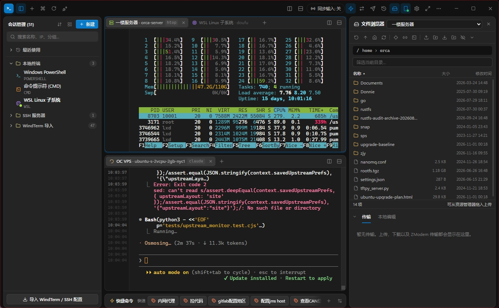
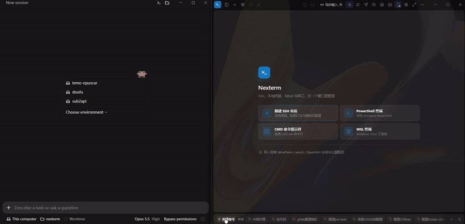
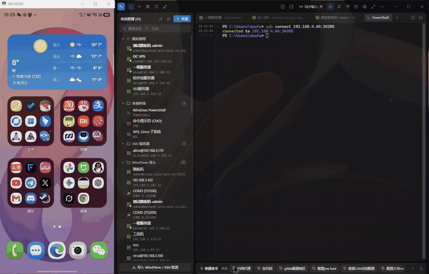
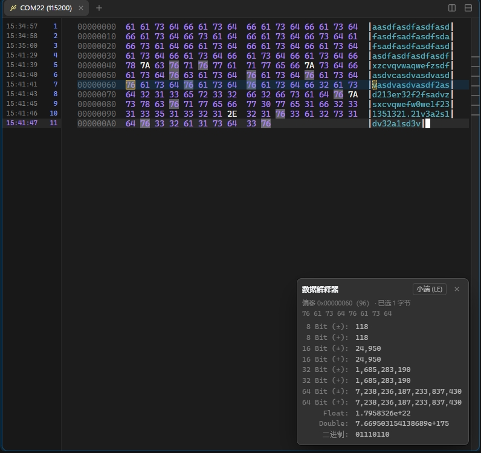

# Nexterm

[English](README.md) | 简体中文


**Nexterm** 是一款高性能 Windows 终端客户端，基于 Rust + Tauri v2 + React + [xterm.js](https://xtermjs.org) 构建，支持 **SSH、本地 Shell（PowerShell / CMD / WSL）、Telnet、Raw TCP、串口、Android（ADB）** 以及内嵌 **RDP / VNC** 远程桌面。

延续 WindTerm 的高效交互（会话树、嵌套分屏、快捷命令、一键迁移），面向日常开发、运维与 AI 协同场景打造。仅支持 Windows 10 / 11，当前版本 `0.1.17`（[下载发布版](https://github.com/rty813/nexterm/releases)）。



## 核心亮点

- **全协议与远程桌面**：在一个窗口内并排使用 SSH、本地 ConPTY、串口、ADB 与内嵌 RDP / VNC。
- **一体化文件工作流**：SFTP 侧边栏（无 SFTP 自动降级 SCP），支持并发传输、免下载预览与**本地编辑保存自动回传**。
- **AI Agent 深度协同**：实时感知 **Claude Code / Codex / Gemini CLI** 状态并推送桌面通知；内置人工审批的 **MCP 服务器**。
- **零知识远程访问与会话分享**：手机 / 浏览器扫码即连，端到端加密；支持一次性链接分享单个终端并按需授权控制。
- **无限回滚与插件扩展**：后端 zstd 压缩保存全部输出历史，无缝回滚与毫秒级全量搜索；支持可安装插件与插件商店。

## 功能概览

### 连接与协议

- **SSH**（`russh`）：密码、交互式与私钥认证（OpenSSH / PEM，Ed25519 / RSA），支持 ProxyJump 跳板机、ProxyCommand、保活、登录后脚本与主机密钥确认。
- **代理与防空闲**：支持 SOCKS5 / SOCKS4(a) / HTTP CONNECT 代理；后端防空闲自动发送（避开全屏程序与运行中命令），防止 `TMOUT` 注销。
- **本地与硬件**：内置新版微软 ConPTY（OpenConsole）运行 PowerShell / CMD / WSL；支持 Telnet、Raw TCP 与串口。
- **内嵌 RDP / VNC**：支持 NLA、TOFU 证书确认、双向剪贴板（含文件/文件夹）、本机音频播放、随窗格自适应分辨率与 macOS 屏幕共享，可走 SSH 跳板机或代理。
- **端口转发与终端传输**：本地（`-L`）/ 远程（`-R`）/ 动态（`-D`）转发；内置 VcXsrv 一键 X11 转发；支持 **ZMODEM / XMODEM / YMODEM**（含接收重名冲突处理）与会话日志。
- **Shell 集成**：自动注入目录与命令追踪（OSC 133 / 633 / 7），支持 SSH（`bash` / `zsh` / `fish`）、WSL 与本地 PowerShell，也可右键一键安装到嵌套 Shell / 串口。

### 远程文件浏览器（SFTP / SCP）

- **自动降级与联动**：`Ctrl+Shift+O` 打开，无 SFTP 时自动降级 SCP + Shell；支持路径补全、**跟随终端 `cd`** 与跨服务器常用目录书签（`Ctrl+D`）。
- **预览与本地编辑**：免下载预览代码、JSON、Markdown、CSV/TSV、图片与 PDF；用本机编辑器打开远端文件，保存即自动回传。
- **高吞吐并发队列**：支持拖拽上传、权限修改、暂停 / 续传 / 重试与冲突策略，统一展示 ZMODEM 进度；高延迟链路（200 ms）下 SFTP 上传约快 4 倍、下载约快 3.5 倍。

### Android 设备（ADB）

- **直连 adb server**：支持 USB / 无线调试 / Android 11+ 配对，自动定位或一键下载官方 `platform-tools`；快速连接栏支持 `adb`、`adb <序列号|IP>`。
- **屏幕镜像与录屏**：内置 [scrcpy](https://github.com/Genymobile/scrcpy) 服务端 + WebCodecs 硬件解码，支持键鼠/中文输入、熄屏镜像、双向剪贴板、截图与无重编码 MP4 录屏。
- **Logcat 与设备管理**：工作区独立 Logcat 标签页（按级别、`tag:`、`pid:`、`package:`、正则实时筛选且不丢日志）；支持设备文件浏览、APK 安装/导出、应用与进程管理、资源监控。
- **远端主机 ADB**：在 Linux SSH 窗格右键即可透传管理插在远端主机上的 Android 设备（不支持端口转发时自动回退 `nc` 中转）。

### AI Agent 与 MCP 协同

- **实时状态与通知**：标签页自动显示 Claude Code / Codex / Gemini CLI 的**工作中 / 待审批 / 已完成 / 出错**状态；后台任务完成、请求权限或报错时闪屏并弹窗通知，点击直达窗格。
- **一键 Hooks + 读屏兜底**：本机、SSH 与 WSL 一键安装状态 Hooks，未安装时自动回退读屏识别。
- **受控 MCP 托管**：将 Nexterm 注册为 MCP 服务器，AI 可读屏、查历史、执行命令、操作 `vim` / `top` 等交互程序，并在 SSH 窗格上浏览目录与上传/下载文件。每次接管或新建会话均需**弹窗确认**，托管期间自动锁键盘，随时可暂停或收回控制。

<p align="center">
  <a href="docs/media/mcp-demo.mp4"></a>
  <br />
  <sub>Claude Code 通过内置 MCP 打开 WSL 窗格、查看磁盘占用后自动关闭（2.5 倍速，点击查看完整视频）。</sub>
</p>

### 远程访问与会话分享

- **自建中继 + 端到端加密**：配套轻量自建中继（[relay/README.md](relay/README.md)，含 Docker），扫码或打开链接即可从手机 / 浏览器操控电脑终端；密钥仅存于 URL `#` 后，中继只转发 AES-256-GCM 密文。
- **移动友好与完整能力**：支持 PWA 添加到主屏幕、触控快捷栏与**「接管尺寸」**自适应屏幕；支持远程登录/确认主机密钥、会话管理、最大 1 GB 文件传输及只读模式（最多 8 台设备）。
- **一次性会话分享**：右键标签/窗格生成独立临时链接与二维码（内存密钥，关闭/到期即失效）；访客免安装默认只读，申请控制并经批准后可单人输入与接管尺寸。

<p align="center">
  <a href="docs/media/phone-remote.mp4"></a>
  <br />
  <sub>手机端直接操控电脑 SSH 会话，「接管尺寸」自动适配屏幕（1.5 倍速，点击查看完整视频）。</sub>
</p>

### 工作区、触发器与二进制调试

- **灵活布局与高效输入**：多级会话树、任意嵌套分屏与标签拖出独立窗口；快速连接栏（`ssh` / `rdp://` / `vnc://` / `adb` / `wsl` / `powershell`）、**广播输入**、多会话定时发送器、命令面板、多行分组快捷命令与历史/词库自动补全。
- **阅读与提醒**：命令完成弹窗提醒（含耗时与退出码）、输出折叠、关键字高亮、专注模式（`F11`）、窗口置顶、锁屏与关闭到托盘。
- **触发器**：内置超链接（含 OSC 8）、十六进制转十/八进制、Unix 时间戳转换、压缩包一键生成解压命令；支持正则、命名分组与隔离 Worker 脚本自定义触发器。
- **串口与二进制（Hex）**：串口 / Raw TCP 支持十六进制视图、内置 **WinHex 风格数据解释器**（点选任意字节即看大/小端 8–64 位整型、浮点与二进制位，单击复制）及多格式 Hex 发包器。



### 完整回滚与搜索

- **无缝回滚全部历史**：可一直上滚至会话第一行，滚动条按全量历史定位；支持全历史正则/全词搜索（`Ctrl+Shift+F`）与滚动条命中标记。
- **时间行号与导出**：`Ctrl+Shift+S` 显示每行时间戳与行号；「保存到文件」及 MCP `read_history` / `search_history` 均覆盖完整历史，内存与临时文件上限可在设置中调整。

### 同步、迁移与个性化

- **云同步与版本恢复**：支持同步至 **S3 兼容存储、WebDAV、GitHub Gist、本地/网络文件夹**，提供冲突合并、历史版本回滚与加密导出/导入（PBKDF2 + AES-256-GCM）；本机专属配置自动隔离。
- **一键迁移**：支持从 **WindTerm**（含可选密码、快捷命令与配色）、`~/.ssh/config`、**Xshell**、**MobaXterm**、**SecureCRT** 与 **FinalShell** 导入会话。
- **安全与运维工具**：凭据管理器（多会话共用密钥/密码）；本机凭据与敏感配置经 Windows DPAPI 加密；Linux SSH 会话内置「服务器资源」实时监控面板。
- **个性化与维护**：20 套内置主题 + 自定义主题 + 终端背景图；可自定义快捷键、工具栏、中英文界面与设置搜索（`Ctrl+F`）；支持 GitHub Releases 应用内自动更新（校验 SHA-256）与应用代理设置。

### 插件（实验版）

支持在**设置 → 插件**中安装本地 `.nexterm-plugin` 包或添加公开插件商店（首次信任 Ed25519 公钥并校验包哈希），安装前展示权限审批，支持启停、重载、排序与同步。**请仅安装来源可信的插件**（不支持 VS Code `.vsix`）。

快速体验：运行 `node scripts/pack-plugin.mjs plugins/hello` 打包 [Hello 模板](plugins/hello/) 后安装。

- [插件开发指南](docs/plugin-sdk.zh-CN.md) · [SDK 类型定义](plugins/sdk/nexterm.d.ts) · [平台设计](docs/plugin-platform.zh-CN.md) · [发布插件商店](docs/plugin-store.zh-CN.md)

## 性能

采用 WindTerm 官方[吞吐测试方法](https://github.com/kingToolbox/WindTerm#terminal-performance)对比（耗时越短越好；Nexterm 默认开启完整回滚历史）：

| 测试项 | Nexterm | WindTerm 2.7.0 |
| --- | --- | --- |
| `cat` 100 MB 随机 base64 文本 | 5.53 s | **4.98 s** |
| `seq 1 1000000` | **1.43 s** | 2.04 s |
| `seq 1 2000000` | **2.23 s** | 2.97 s |
| `seq 1 5000000` | 5.38 s | **4.73 s** |
| `seq 1 10000000` | 10.15 s | **7.54 s** |

内存占用（整个进程树专用工作集，含 WebView2）：

| 状态 | Nexterm | WindTerm 2.7.0 |
| --- | --- | --- |
| 空闲，打开一个会话 | 218 MB | **43 MB** |
| 输出 `seq 1 1000000` 后 | 峰值 350 MB，稳定后 248 MB | **75 MB** |

<details>
<summary>测试环境、内存分析与复现方式</summary>

- **内存去向**：约 170 MB 为 WebView2 固定开销；xterm.js 仅保留最近 1 万行，更早内容压缩存在后端（输出 `seq 1 1000000` 后 `nexterm.exe` 本身约占 20 MB），峰值主要为待回收的 JS 垃圾。
- **完整历史开销**：后端独立线程解析并压缩输出，高吞吐时约多占 1 个 CPU 核心；连续单次测 `seq 1 10000000`，开启 8.9 s、关闭 8.7 s。
- **测试环境**：AMD Ryzen 7 5700G / 32 GB RAM / Windows，经 Telnet 连接本机 WSL，同窗口尺寸，预热 1 次后取 3 次中位数（DSR 回包计时；WindTerm 不回复 DSR，按 CPU 回落空闲计时）。
- **复现**：在被测终端运行 [`bench/bench.sh`](bench/bench.sh)，在 Windows 上运行 [`bench/mem.ps1`](bench/mem.ps1)。

</details>

<details>
<summary>技术实现：完整回滚历史如何在 WebView 中做到低内存与毫秒级搜索</summary>

WebView 里的 xterm.js 按字符格存储（12 字节/格），直接存 1000 万行需约 15 GB。Nexterm 在 Rust 后端保存全量历史并按需喂给前端（[`src-tauri/src/history/`](src-tauri/src/history/)、[`src/services/historyScroll.ts`](src/services/historyScroll.ts)）：

1. **后端无界面终端**：输出在发往 xterm.js 的同时复制给后台 [`alacritty_terminal`](https://crates.io/crates/alacritty_terminal)，准确还原光标移动、`\r` 进度条与清屏，并按逻辑行合并自动折行。
2. **紧凑压缩**：每行仅存文本、颜色区段与时间戳，每 2000 行一块用 zstd 压缩（`seq 1 10000000` 约 78 MB 文本压缩后仅 ~6 MB）。
3. **有界内存 + 加密落盘**：单窗格超过内存上限（默认 32 MB）时，最旧块用内存随机密钥（AES-256-GCM）加密写入临时文件，关闭即删；超磁盘上限（默认 2 GB）则淘汰最旧行。
4. **无缝按需拼接**：上滚接近缓冲区顶部时，前端向后端拉取更早行并直接拼入 xterm.js（最多额外加载 ~3 万行，回到底部即释放），选择、复制、触发器与高亮全部无感生效。
5. **多线程全量搜索**：后端先对块文本做整块初筛再逐行定位，1000 万行全扫约 0.1 s，并缓存每块命中数以加速滚动条标记。

</details>

## 从源码构建

环境要求：[Node.js](https://nodejs.org) >= 20、[Rust](https://rustup.rs) stable（MSVC）、[Tauri v2 Windows 依赖](https://tauri.app/start/prerequisites/)。

```powershell
git clone https://github.com/rty813/nexterm.git
cd nexterm
npm install

npm run tauri:dev      # 开发模式
npm run tauri:build    # 生产构建 → src-tauri/target/release/nexterm.exe（构建前请退出已运行的实例）
```

运行测试：

```powershell
npm test                                                 # 前端测试（Vitest）
cargo test --manifest-path src-tauri/Cargo.toml --lib    # Rust 单元测试
cd relay; npm test                                       # 中继与加密协议测试
```

### 目录结构

| 路径 | 说明 |
| --- | --- |
| `src/` | 前端（React + TypeScript），`utils/` 存放与 UI 解耦的纯逻辑与单元测试 |
| `src-tauri/` | Rust 后端：协议与代理、RDP / VNC、SFTP / SCP、ADB / scrcpy、完整历史、MCP、远程访问与分享等 |
| `relay/` | 远程访问自建中继、PWA 与会话分享页（Node.js） |
| `plugins/` | Hello 示例插件与 SDK 类型定义 |
| `bench/` | 吞吐与内存基准测试脚本 |

## 参与与社区

- 欢迎提交 Issue 与 PR；提交前请运行前端和 Rust 测试，新增界面文案需同时提供中英文。
- 社区交流：[LINUX DO](https://linux.do/)

## 许可证

[MIT](LICENSE-MIT) 或 [Apache-2.0](LICENSE-APACHE) 双许可证任选其一。Windows 构建内置的 [VcXsrv](https://sourceforge.net/projects/vcxsrv/)（`src-tauri/resources/vcxsrv/`）为独立 GPL-2.0 程序，随包附带的 [scrcpy](https://github.com/Genymobile/scrcpy) 服务端（`src-tauri/resources/scrcpy/`）为 Apache-2.0，其余依赖遵循各自许可证。
